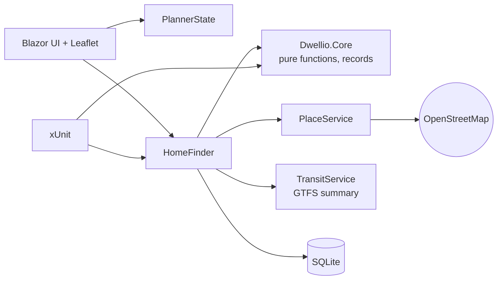

# Introduction to Functional programming
# IT-2502
# Group members:Anuarbek Nurkadyr, Daulet Ulgaisyn


# Dwellio

Dwellio helps students and newcomers choose where to live in Astana around the place they go every day. Pick your university or office, choose what you want within walking distance (gym, spa & sauna, restaurants, cafés, groceries, pharmacy, parks and more), and Dwellio:

- ranks homes and finds the **best areas** where those places are a short walk away, using real OpenStreetMap data;
- plans the **bus ride** with real GPS timing and estimates your **chance of a seat**, suggesting tactics such as walking back to an emptier stop or leaving earlier;
- compares monthly costs, everyday places and commute side by side.

Built with C# / .NET 10, Blazor, Entity Framework Core, SQLite and Leaflet. All decisions are pure functions over immutable records in `Dwellio.Core`. Every data source is free and needs **no API key or sign-up**.

## Screenshots

Captured 2026-11-15 in Chromium at 1440×1000 (desktop) and 390×844 (emulated phone).

| Screen | Desktop | Mobile |
|---|---|---|
| Home | [Desktop](docs/screenshots/home-desktop.jpg) | [Mobile](docs/screenshots/home-mobile.jpg) |
| Planner — homes | [Desktop](docs/screenshots/plan-desktop.jpg) | [Mobile](docs/screenshots/plan-mobile.jpg) |
| Planner — best areas | [Desktop](docs/screenshots/areas-desktop.jpg) | [Mobile](docs/screenshots/areas-mobile.jpg) |
| Home details | [Desktop](docs/screenshots/home-details-desktop.jpg) | [Mobile](docs/screenshots/home-details-mobile.jpg) |
| Commute & seat planner | [Desktop](docs/screenshots/commute-desktop.jpg) | [Mobile](docs/screenshots/commute-mobile.jpg) |
| Compare | [Desktop](docs/screenshots/compare-desktop.jpg) | [Mobile](docs/screenshots/compare-mobile.jpg) |

## How to use it

1. **Plan my move** (`/plan`): search where you go every day. Tap a place type once for *want*, twice for *must-have*. Set walking distance, arrival time, seat/speed preference and budget. Results update instantly; your plan is remembered in the browser.
2. **Homes** tab: ranked homes with fit score, commute and walking minutes per need. Homes that miss a requirement are listed separately with the reason.
3. **Areas** tab: the best neighbourhoods on the map, even without a listing. Tap the map to check any spot.
4. **Home page** (`/homes/{id}`): nearest real places, the bus plan with seat chance and load chart, monthly costs and why it fits.
5. **Commute** (`/commute`): plan any trip, compare tactics, explore how full buses 10, 12 and 46 get by time of day.
6. **Compare** up to three homes; **sign in** to save homes and keep your plan on every device. Owners can publish listings.

## Run locally

Install Git and .NET SDK 10. C# Dev Kit is recommended for VS Code.

```sh
git clone https://github.com/Nkdr21/final-project.git
cd final-project
dotnet restore
dotnet run --project src/Dwellio.Web --launch-profile http
```

Open [http://localhost:5180](http://localhost:5180) after the terminal reports that the server is listening. Stop with `Ctrl+C`.
This is a local address, not a hosted demo: each reviewer must run the app on their own computer. If the repository is already downloaded, run the last two commands from its root folder.
To open the running app on a phone connected to the same Wi-Fi, restart it with this profile and visit `http://<computer-LAN-IP>:5180` on the phone (for example, `http://192.168.0.16:5180`). The computer's LAN IP can be found with `hostname -I` on Linux or `ipconfig` on Windows. The computer's firewall must allow incoming connections on port 5180.
VS Code also provides **Terminal → Run Task → Dwellio: run**.

Internet is optional: without it the app uses the bundled OpenStreetMap snapshot and the map tiles are hidden. To force offline mode set `OpenData__LiveRequests=false`.
Local SQLite databases are created under `src/Dwellio.Web/App_Data/` and excluded from Git. When the housing schema changes, the local housing database is rebuilt automatically (local favourites, reviews and owner listings are reset).

## Test accounts

Register through **Sign in → Register as a new user**. Select **I want to publish listings** for Owner; otherwise the role is Student. Public Admin registration is not available.
Setting the local environment variable `DWELLIO_DEMO_PASSWORD` before startup creates `student@dwellio.test`, `owner@dwellio.test` and `admin@dwellio.test` if they do not exist. Choose a value satisfying Identity rules; do not commit it.

## Tests

```sh
dotnet build
dotnet test                                     # 98 tests
python3 scripts/http_smoke.py                   # with the app running
npm ci --prefix scripts && node scripts/browser-audit.mjs   # needs Chrome
DWELLIO_BROWSER=firefox node scripts/browser-audit.mjs      # after: npx playwright install firefox
DWELLIO_MOBILE=1 node scripts/browser-audit.mjs             # 390 px phone profile
```

Last check on 2026-11-15: build with zero warnings, 98 tests passed. HTTP smoke test and browser audit passed in Chromium (desktop and phone profile) and Firefox. Lighthouse accessibility on the planner: 1.0 on mobile and desktop. See [testing](docs/testing.md). [GitHub Actions](https://github.com/Nkdr21/final-project/actions) runs build and tests on Windows, Linux and macOS, then the browser checks on Linux.

## Data sources

| Data | Source |
|---|---|
| Places and bus stops | © [OpenStreetMap](https://www.openstreetmap.org/copyright) contributors (ODbL) — bundled snapshot + live [Overpass API](https://overpass-api.de) |
| Address search | [Nominatim](https://nominatim.org), [Photon](https://photon.komoot.io) |
| Bus timing (routes 10, 12, 46) | Mansurova et al., [Zenodo 10.5281/zenodo.15769359](https://doi.org/10.5281/zenodo.15769359), CC BY 4.0 |
| Asking rents | [krisha.kz](https://krisha.kz) listings, linked |
| Maps | [Leaflet](https://leafletjs.com) (BSD-2, bundled) |

Details, licences and limits: [data sources](docs/data-sources.md).

## Project structure

| Path | Purpose |
|---|---|
| `src/Dwellio.Core/` | Pure C#: geo maths, place catalogue and spatial index, area analysis, seat model, journey planner, home matching |
| `src/Dwellio.Web/` | Blazor pages and components, state container, open-data clients, accounts, database, bundled data |
| `tests/Dwellio.Tests/` | Unit, integration (SQLite, real data) and service tests with fake HTTP/browser storage |
| `docs/` | Architecture, data model, sources, calculations, testing, presentation material, grading evidence, defence guide |
| `scripts/` | Open-data snapshot builders, HTTP smoke test, browser audit |
| `.github/workflows/` | CI build and tests |



See [architecture](docs/architecture.md), [how results are calculated](docs/recommendations.md) and the [lecture mapping](docs/grading-checklist.md#functional-c-lecture-mapping).

## Limitations

- **Seat chance is an estimate** from 2024 GPS dwell times, not a live passenger count. Only buses 10, 12 and 46 have open timing; other trips show a labelled estimate between real stops.
- OpenStreetMap is volunteer-mapped: some places are missing (few gyms are mapped in Astana).
- "Sample price" homes are real buildings with illustrative rents; sourced rents may be outdated.
- Email confirmation is disabled; server deployment is not verified.
- Safari (WebKit) and physical phones are not tested. Accessibility is checked automatically on the planner page only; manual screen-reader testing is still to do.

## Contributors

`Nkdr21` and `Surrare`. Responsibilities are described in the [team plan](docs/team-plan.md). Actual contributions must be checked against commits and Pull Requests.

## Documentation

- [Architecture](docs/architecture.md)
- [Data model](docs/data-model.md)
- [Data sources](docs/data-sources.md)
- [How results are calculated](docs/recommendations.md)
- [Presentation material](docs/presentation.md)
- [Presentation slides](docs/Dwellio-presentation.pptx) (19 slides with speaker notes)
- [Testing](docs/testing.md)
- [Grading evidence and lecture mapping](docs/grading-checklist.md)
- [Team plan](docs/team-plan.md)
