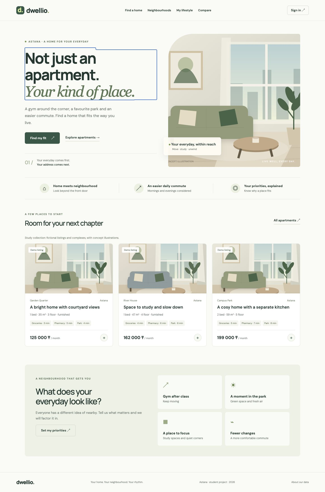
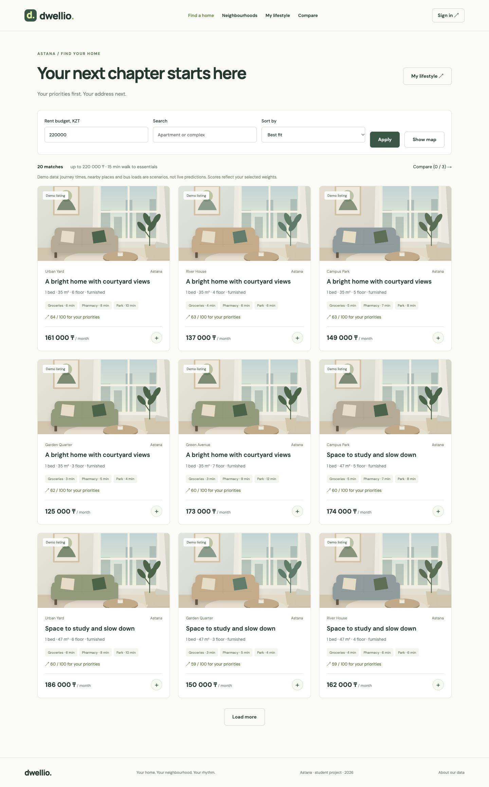
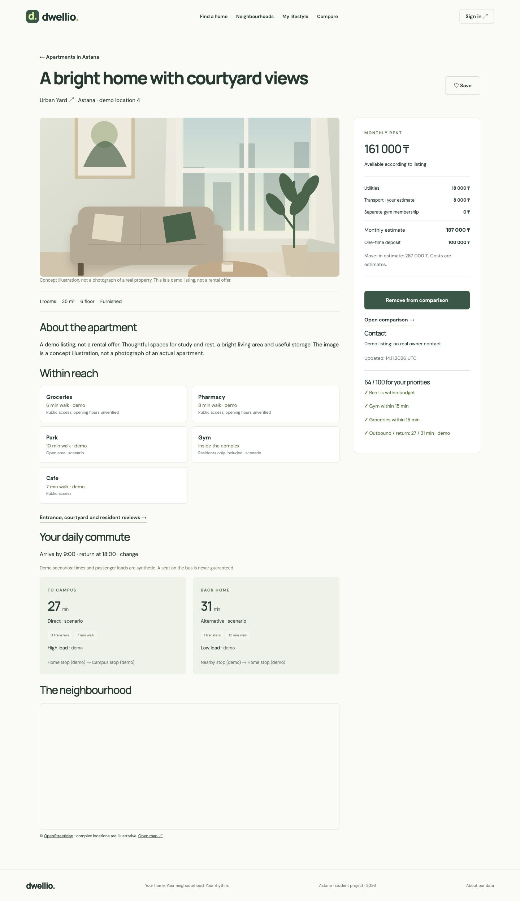
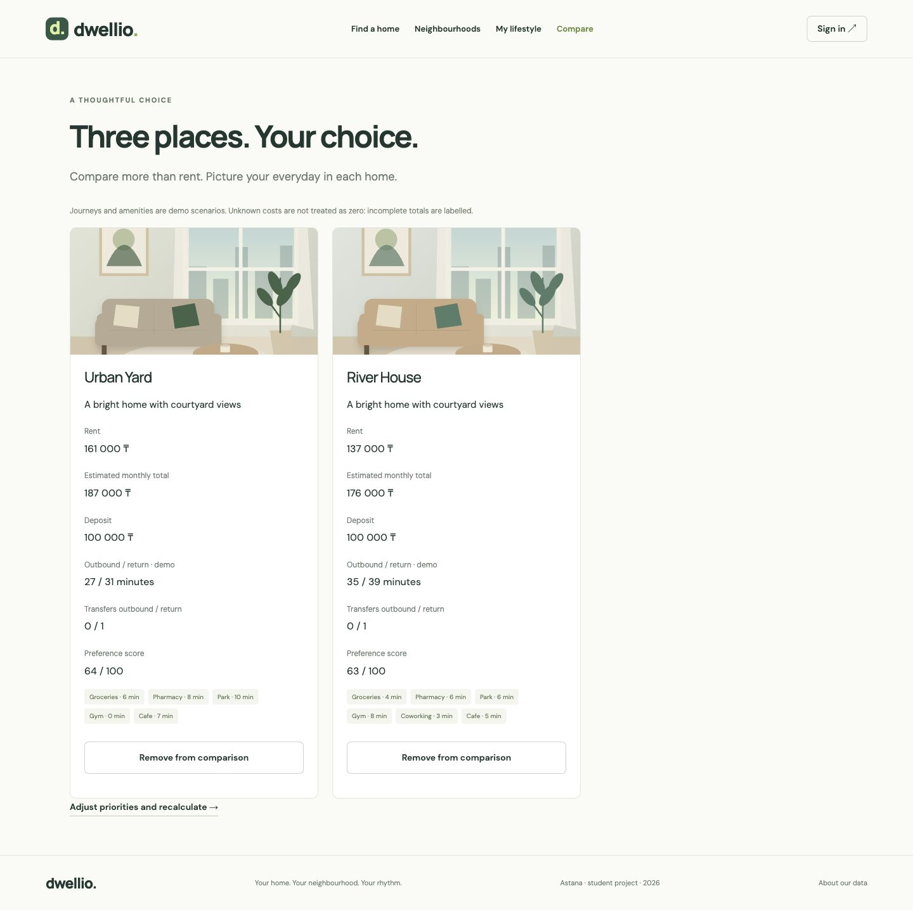
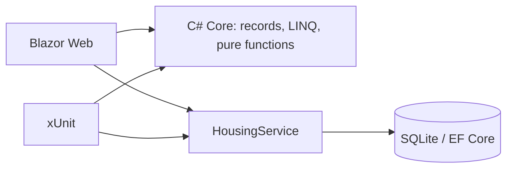

# Dwellio

Dwellio — учебное веб-приложение для подбора студенческого жилья в Астане с учётом бюджета, удобств и поездок на учёбу и обратно. Написано на C#/.NET 10 и Blazor Web App; данные хранятся в SQLite через Entity Framework Core. Учебный акцент — чистые функции, records, LINQ, pattern matching и тестирование логики C#.

## Скриншоты

Сняты 15.11.2026 в Chrome: desktop — 1440×1000, mobile — 390×844 (эмуляция размера, не физический телефон).

| Экран | Desktop | Mobile |
|---|---|---|
| Главная |  | [Mobile](docs/screenshots/home-mobile.jpg) |
| Подбор жилья |  | [Mobile](docs/screenshots/catalog-mobile.jpg) |
| Карточка квартиры |  | [Mobile](docs/screenshots/apartment-mobile.jpg) |
| Сравнение |  | [Mobile](docs/screenshots/compare-mobile.jpg) |

## Возможности

- Указать бюджет, обязательные удобства и ограничения поездок.
- Найти и отсортировать квартиры по своим предпочтениям.
- Посмотреть расходы, ЖК и объяснение результата подбора.
- Сравнить до трёх квартир, включая расходы и транспортные сценарии.
- Сохранить квартиры в избранное и записать свои предпочтения после входа.
- Найти ЖК по названию и удобствам, прочитать или оставить отзыв.
- Опубликовать и редактировать свои объявления с ролью Owner; с ролью Admin — скрывать и восстанавливать объявления и отзывы.

## Запуск

Требуется .NET SDK 10. Для VS Code рекомендуется C# Dev Kit.
Из корня репозитория:

```sh
dotnet restore
dotnet run --project src/Dwellio.Web --launch-profile http
```

Откройте [http://localhost:5180](http://localhost:5180). Остановка — `Ctrl+C`.
В VS Code также доступно **Terminal → Run Task → Dwellio: run**.
Локальные базы автоматически создаются в `src/Dwellio.Web/App_Data/` и исключены из Git.

## Тестовые аккаунты

Обычный аккаунт создаётся через **Sign in → Register as a new user**.
Флажок **I want to publish listings** выбирает роль Owner; без него создаётся Student.
Публичная регистрация Admin отсутствует.
При запуске с заданной переменной окружения `DWELLIO_DEMO_PASSWORD` создаются демонстрационные аккаунты `student@dwellio.test`, `owner@dwellio.test`, `admin@dwellio.test`, если их ещё нет.
Значение задаётся локально и должно соответствовать требованиям Identity. Пароли в репозитории не хранятся; изменение переменной не сбрасывает существующие пароли.

## Тесты

```sh
dotnet build
dotnet test
dotnet test --collect:"XPlat Code Coverage"
```

Проверено 15.11.2026 на macOS: build — 0 ошибок, 0 предупреждений; тесты — 38 прошли, 0 упали, 0 пропущены (до и после реорганизации).
[GitHub Actions](https://github.com/Nkdr21/final-project/actions/runs/43634904148): задания Windows, Linux и macOS завершились успешно.
При запущенном приложении `python3 scripts/http_smoke.py` проверяет HTTP-страницы и перенаправления.
Область тестов и ручные проверки: [docs/testing.md](docs/testing.md).

## Структура проекта

| Папка или файл | Назначение |
|---|---|
| `src/Dwellio.Core/` | Модели C#, расчёты подбора и стоимости, фильтры удобств, транспортные сценарии |
| `src/Dwellio.Web/` | Страницы Blazor, аккаунты, сервисы, база данных, стили |
| `tests/Dwellio.Tests/` | Unit-тесты и интеграционные тесты с SQLite |
| `docs/` | Архитектура, данные, критерии курса, тестирование и план команды |
| `docs/screenshots/` | Снимки экранов приложения |
| `scripts/` | HTTP smoke-проверка |
| `.github/workflows/` | Автоматическая сборка и тесты |
| `.vscode/` | Задачи запуска и рекомендации расширений |
| `Dwellio.slnx`, `global.json` | Состав решения и выбор SDK |

## Архитектура и C#

`Core` содержит вычисления без доступа к базе; `Web` связывает интерфейс, авторизацию и хранение данных. Тесты проверяют вычисления и операции сервиса.



Подробности: [архитектура](docs/architecture.md), [C# и материалы лекций](docs/grading-checklist.md#functional-c-lecture-mapping).

## Данные

Исходные 8 ЖК и 32 квартиры, цены, координаты, удобства, время поездок и загруженность автобусов — демонстрационные данные. SVG-изображения — иллюстрации, не фотографии объектов.
OpenStreetMap используется для внешней карты. Данные и изображения, добавленные пользователями, приложением не проверяются.
Подробнее: [источники и ограничения данных](docs/data-sources.md).

## Ограничения

- Email-подтверждение отключено; отправка писем не настроена.
- Рабочий deployment серверного приложения не проверен; успешная публикация GitHub Pages не подтверждает работу Blazor Server и SQLite.
- Автоматических browser end-to-end тестов нет; HTTP smoke их не заменяет.
- Список сравнения сбрасывается при полном обновлении страницы.
- Нет реальных транспортных прогнозов, проверки цен и подтверждения проживания авторов отзывов.
- Каталог загружает не более 500 записей; расчёт и пагинация выполняются в памяти. Нагрузочные показатели не проверены.
- Для housing-базы используется `EnsureCreated`; дальнейшее изменение схемы требует плана миграций.
- Загрузка изображений ограничена 5 MB и базовой проверкой формата; квоты и очистка неиспользуемых файлов не реализованы.
- Полная проверка доступности, нескольких браузеров и реальных мобильных устройств не завершена.

## Участники

`Nkdr21` и `Surrare`. Области ответственности описаны в [плане команды](docs/team-plan.md); фактические изменения участников проверяются по истории Git и Pull Request.

## Документация

- [Архитектура и назначение папок](docs/architecture.md)
- [Модель данных](docs/data-model.md)
- [Источники данных](docs/data-sources.md)
- [Правила подбора](docs/recommendations.md)
- [Критерии курса и материалы C#](docs/grading-checklist.md)
- [Проверки и тесты](docs/testing.md)
- [План команды](docs/team-plan.md)
- [План защиты](docs/defense.md)
