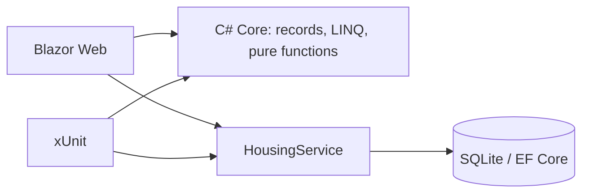

# Dwellio

Dwellio is a student housing web application for Astana that explores rent, everyday amenities and travel preferences. It uses C#/.NET 10, Blazor Web App, Entity Framework Core and SQLite. The coursework focuses on records, pure functions, LINQ, pattern matching and testing C# business logic.

## Screenshots

These screenshots show the earlier layout, before real rental cards were integrated into the catalog. Updated screenshots of the current catalog are not yet captured. Chrome sizes: desktop 1440×1000 and mobile 390×844 (viewport emulation, not a physical phone).

| Screen | Desktop | Mobile |
|---|---|---|
| Home | [Desktop](docs/screenshots/home-desktop.jpg) | [Mobile](docs/screenshots/home-mobile.jpg) |
| Catalog | [Desktop](docs/screenshots/catalog-desktop.jpg) | [Mobile](docs/screenshots/catalog-mobile.jpg) |
| Apartment | [Desktop](docs/screenshots/apartment-desktop.jpg) | [Mobile](docs/screenshots/apartment-mobile.jpg) |
| Comparison | [Desktop](docs/screenshots/compare-desktop.jpg) | [Mobile](docs/screenshots/compare-mobile.jpg) |

## Features

- Browse sourced Astana rental examples in the main catalog, filter by rent, address or Mangilik El avenue, and open the original listing.
- View source listing photos where available, review dates, deposits and archived-price labels.
- Explore the expandable demo matching workflow with budget, amenity and commute preferences.
- Compare up to three demo apartments, including costs and journey scenarios.
- Save homes and preferences after signing in.
- Search demo complexes by amenities and submit reviews.
- Publish and edit your own listings as Owner; hide or restore listings and reviews as Admin.

## Run locally

Install .NET SDK 10. C# Dev Kit is recommended for VS Code. From the repository root:

```sh
dotnet restore
dotnet run --project src/Dwellio.Web --launch-profile http
```

Open [http://localhost:5180](http://localhost:5180). Stop with `Ctrl+C`.
VS Code also provides **Terminal → Run Task → Dwellio: run**.
Local SQLite databases are created under `src/Dwellio.Web/App_Data/` and excluded from Git.

## Test accounts

Register through **Sign in → Register as a new user**. Select **I want to publish listings** for Owner; otherwise the role is Student. Public Admin registration is not available.
Setting the local environment variable `DWELLIO_DEMO_PASSWORD` before startup creates `student@dwellio.test`, `owner@dwellio.test` and `admin@dwellio.test` if they do not exist. Choose a value satisfying Identity rules; do not commit it. Changing the variable does not reset existing passwords.

## Tests

```sh
dotnet build
dotnet test
dotnet test --collect:"XPlat Code Coverage"
```

Last completed check on 2026-11-15: 41 tests passed, none failed or skipped; build completed with zero errors and warnings. Photo/catalog HTTP checks and remaining visual checks are recorded in [testing notes](docs/testing.md).
An earlier [GitHub Actions run](https://github.com/Nkdr21/final-project/actions/runs/43634904148) passed on Windows, Linux and macOS; it does not verify subsequent unpushed changes.
With the app running, `python3 scripts/http_smoke.py` checks public HTTP pages and authorization redirects. It does not replace browser E2E tests.

## Project structure

| Path | Purpose |
|---|---|
| `src/Dwellio.Core/` | C# models, matching and cost calculations, amenity filters, route scenarios |
| `src/Dwellio.Web/` | Blazor pages, accounts, services, database, styles and sourced rental references |
| `tests/Dwellio.Tests/` | Unit tests and SQLite integration tests |
| `docs/` | Architecture, data, grading evidence, testing and team plan |
| `docs/screenshots/` | Application screenshots |
| `scripts/` | HTTP smoke checks |
| `.github/workflows/` | Automated builds and tests |
| `.vscode/` | Run tasks and extension recommendations |
| `Dwellio.slnx`, `global.json` | Solution projects and SDK selection |

## Architecture and C#

Core contains calculations without database access. Web connects the interface, authorization and persistence. Tests cover calculations and service operations.



See [architecture](docs/architecture.md) and [lecture mapping](docs/grading-checklist.md#functional-c-lecture-mapping).

## Data

The main catalog contains six sourced rental examples with addresses, asking rents and original listing links. Availability is unconfirmed, one example is archived, and one source has conflicting prices. Photos load from the original listing provider where a photo URL was retrieved; failed images show a fallback.
The expandable demo workflow uses eight fictional complexes and 32 apartments with synthetic coordinates, prices, amenities, routes and bus loads. Its SVG images are illustrations. Real examples are not assigned synthetic scores and are not yet integrated with demo comparison or favorites.
See [data sources](docs/data-sources.md) for provenance and limitations.

## Limitations

- Email confirmation is disabled and email delivery is not configured.
- Server deployment is not verified; GitHub Pages does not run Blazor Server and SQLite.
- No repeatable browser E2E suite or completed accessibility/cross-browser audit exists.
- Comparison persists through reload in the same tab using `sessionStorage`; it is not synchronized across devices. Blocked storage limits persistence to the current circuit.
- Live routing, bus occupancy and rental availability are not verified. Reviewer residency is not verified.
- Demo catalog computation is in memory with a 500-record cap; load performance is not measured.
- The housing database uses `EnsureCreated`; schema changes need a migration plan.
- Uploads have a 5 MB limit and basic signature checks; quotas and orphan cleanup are not implemented.
- External source photos require internet and may disappear. Photo reuse permissions for redistribution have not been established.

## Contributors

`Nkdr21` and `Surrare`. Responsibilities are described in the [team plan](docs/team-plan.md). Actual contributions must be checked against commits and Pull Requests.

## Documentation

- [Architecture and folders](docs/architecture.md)
- [Data model](docs/data-model.md)
- [Data sources](docs/data-sources.md)
- [Recommendation rules](docs/recommendations.md)
- [Grading evidence and C# lectures](docs/grading-checklist.md)
- [Testing](docs/testing.md)
- [Team plan](docs/team-plan.md)
- [Defense outline](docs/defense.md)
