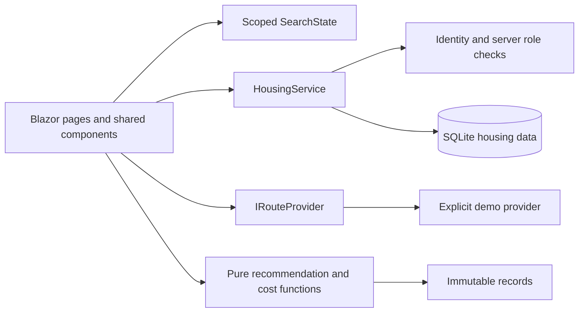

# Architecture

Dwellio uses a functional core surrounded by database and UI adapters. Core calculations never read the clock, fetch HTTP data or change database records. This allows deterministic tests and clear explanations during the defence.

## Responsibilities

- `Dwellio.Core/Models/Housing.cs`: values and explicit route outcomes.
- `RecommendationEngine`: validation, mandatory filters, route selection, scoring and cost calculation.
- `NeighborhoodService`: reusable pure amenity filtering/grouping.
- `DemoRouteProvider`: deterministic teaching scenarios behind an interface; replace with a researched real provider later.
- `HousingService`: authorization, validation and persistence. Never trusts a user ID supplied by a browser form.
- `SearchState`: per-circuit preferences and comparison IDs. Comparison IDs are restored after interactive rendering from tab-local `sessionStorage` through `comparison.js`; C# validates positive IDs, uniqueness and the three-home limit. No cross-user singleton state.
- `IDbContextFactory`: short-lived contexts per database operation, rather than a long-lived tracked context per circuit.
- Identity: framework password hashing, cookies, antiforgery and lockout on login failures.

## Tradeoffs

SQLite and a single application process keep setup understandable. This is not a claim of production scalability. Catalog loads at most 500 rows, computes in memory and displays batches of nine; larger datasets need server pagination and query optimization. Current maps are embedded OpenStreetMap views, not a routing service. Uploads are limited to 5 MB and basic JPEG/PNG signature checks, with randomized filenames; production needs image decoding/re-encoding, storage quotas and orphan cleanup.

## Folder guide

| Path | Contents |
|---|---|
| `src/Dwellio.Core/Models/` | Records and typed input/output values |
| `src/Dwellio.Core/Services/` | Pure calculations, LINQ filters and route scenarios |
| `src/Dwellio.Web/Components/Pages/` | Catalog, apartment, complex, comparison and account pages |
| `src/Dwellio.Web/Components/Shared/` | Reusable cards, photos, map, amenities and sourced catalog |
| `src/Dwellio.Web/Components/Layout/` | Shared layout and reconnection UI |
| `src/Dwellio.Web/Components/Account/` | ASP.NET Core Identity registration, login and management |
| `src/Dwellio.Web/Data/` | EF entities, contexts, seed data, Identity migrations and market references |
| `src/Dwellio.Web/Services/` | Authorization, persistence and scoped state |
| `src/Dwellio.Web/wwwroot/` | CSS, images and library assets |
| `src/Dwellio.Web/Properties/` | Local launch profiles |
| `tests/Dwellio.Tests/` | C# rules and SQLite integration tests |

`bin/`, `obj/`, `App_Data/` and `TestResults/` are generated locally and excluded from source control.
Start the C# walkthrough with `Housing.cs`, `RecommendationEngine.cs`, `NeighborhoodService.cs` and their tests.

The main catalog renders `MarketCatalog` first and keeps the synthetic matching workflow in an expandable section. `/market` redirects to `/catalog`. Market references are immutable in-memory records, not database replacements. `ListingPhoto` displays an externally hosted source photo or an explicit fallback; source URLs remain available on each card.
