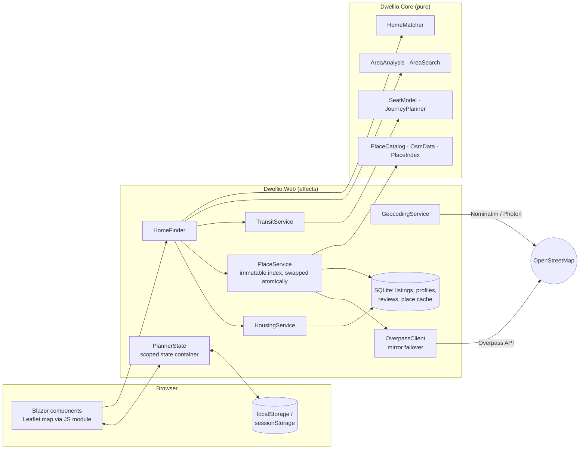

# Architecture

Dwellio has three projects. Decisions live in **Core** as pure functions over immutable records; **Web** gathers inputs (database, open-data APIs, browser storage) and renders Blazor components; **Tests** check both.

## Folders

| Path | Contents |
|---|---|
| `src/Dwellio.Core/Geo` | `GeoPoint`, haversine distance, walking time, Astana bounds |
| `src/Dwellio.Core/Places` | Category catalogue (single source of OSM tag rules), Overpass query/parsers, spatial `PlaceIndex`, `AreaAnalysis` |
| `src/Dwellio.Core/Transit` | GTFS-derived `TransitNetwork`, `SeatModel` (load fold), `JourneyPlanner` (tactics, composable scoring, fallback estimate) |
| `src/Dwellio.Core/Matching` | `HomeMatcher` (validation, sanitising, exclusions, score), `AreaSearch` (best neighbourhoods) |
| `src/Dwellio.Core/Models` | `Preferences`, `Apartment`, `Complex`, `HomeMatch`, `MonthlyCost`, labels |
| `src/Dwellio.Web/Services/OpenData` | Overpass, Nominatim/Photon, place and transit services, options |
| `src/Dwellio.Web/Services` | `PlannerState`, `HomeFinder`, `HousingService`, safe URL parsing |
| `src/Dwellio.Web/Components` | Layout (`MainLayout`, `PlannerScope`), pages, reusable components |
| `src/Dwellio.Web/Data` | EF Core entities, seed data, bundled open data (`Places/`, `Transit/`) |
| `src/Dwellio.Web/wwwroot` | Design system (`app.css`), `js/map.js`, `js/dwellio.js`, Leaflet (BSD-2) |
| `scripts/` | Data snapshot builders, HTTP smoke test, browser audit |

## Request flow: "change a need in the planner"

1. `NeedPicker` raises `Changed` with new arrays (a pure state transition: off → want → must → off).
2. The page calls `PlannerState.Update(p => p with { Needs = …, MustHaves = … })`. The state validates the new value, keeps it, writes it to `localStorage` and raises `Changed`.
3. `PlannerScope` (in the layout) re-renders and cascades the new `Preferences` value to every page.
4. `PlanPage.OnParametersSetAsync` sees a different `CacheKey`, cancels any running computation and calls `HomeFinder.RankAsync`.
5. `HomeFinder` reads listings once, then per complex (cached in `IMemoryCache`) runs `AreaAnalysis.Analyse` and `JourneyPlanner.Plan` on a background thread, and `HomeMatcher.Evaluate` per listing.
6. In parallel `PlaceService.RefreshAsync` asks Overpass for fresher data near the destination. When it arrives, the index is replaced (`ReplaceArea`), `AreaRefreshed` fires and the page recomputes with live data.

## State management

| State | Where | Lifetime |
|---|---|---|
| Plan (`Preferences`) | `PlannerState` → `localStorage`; optional profile row | Survives reloads; profile follows the account |
| Comparison IDs | `PlannerState` → `sessionStorage` | Per browser tab |
| Saved homes, reviews, listings | SQLite via `HousingService` | Permanent |
| Place index | `PlaceService` singleton (immutable, swapped under a lock) | Process; live areas also in SQLite for 72 h |
| Derived results | `IMemoryCache` keyed by `Preferences.CacheKey` + index version | 20 minutes |

Interactive pages are not prerendered: the plan lives in the browser, so rendering once with the real state avoids a flash of defaults and duplicate work. Account pages stay statically rendered because Identity needs HTTP cookies.

## Resilience

- Open data: bundled snapshot → SQLite cache → live request. Each Overpass mirror has its own timeout; failures return `null`, never exceptions, and the UI shows "snapshot" instead of "live".
- Geocoding: popular places and bus stops are local and instant; Nominatim is rate-limited to one request per second with Photon as fallback; offline shows a clear hint.
- Bad input: URL coordinates are parsed safely, stored plans are sanitised, invalid updates are rejected with a message while the previous state stays.
- UI: an `ErrorBoundary` in the layout keeps navigation working and offers "Try again"; the map is optional and every map item is also listed.
- Database: the housing database carries a schema version (`PRAGMA user_version`) and is rebuilt when an older version is found.
