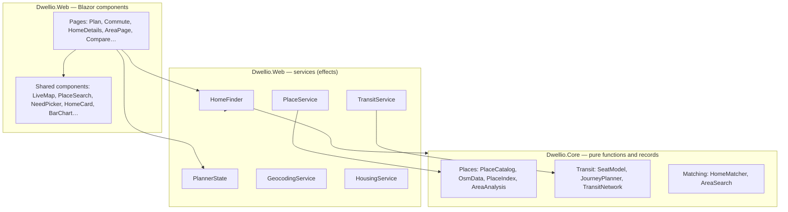
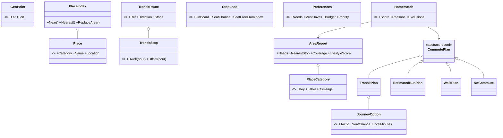

# Presentation material

Written for the group's defence and slides. Every claim here is checked against the repository; figures are from the 2026-11-15 test runs listed in [testing](testing.md).

## 1. Team, topic and aim

- **Team:** Anuarbek Nurkadyr and Daulet Ulgaisyn (group IT-2502, Introduction to Functional Programming). Repository accounts: `Nkdr21` and `Surrare`.
- **Topic:** Dwellio — choosing where to live in Astana around the place you study or work.
- **Aim:** help a student or newcomer find a home where the everyday places they want (gym, spa, café, groceries, pharmacy…) are a short walk away, and get a bus plan with a realistic chance of a seat.

## 2. Goals and plan

| Goal | Done in the project |
|---|---|
| Find homes by daily life, not only rent | Ranked homes, must-haves, reasons for every exclusion |
| Find neighbourhoods without a listing | Area search on a grid around the destination |
| Make commuting easier | Bus plans with walking, waiting and riding times; tactics (walk back, leave earlier) |
| Use free data only | OpenStreetMap, Nominatim/Photon, an open GPS dataset (CC BY 4.0) |
| Keep it correct and tested | 98 automated tests; accessibility score 1.0 (Lighthouse, planner page) |

Plan and status: the planner, data layer and tests are complete; open items are listed in [testing](testing.md#not-yet-verified).

## 3. Analysis of existing technologies and comparison

| Need | Options considered | Chosen | Why |
|---|---|---|---|
| Web UI with C# | ASP.NET MVC (Razor views), Blazor Server, Blazor WebAssembly, React + ASP.NET API | **Blazor Web App (interactive server)** | One language (C#) for UI and logic, which is the course language; component model fits reusable cards and maps; server rendering keeps the bus and place calculations off the browser. WebAssembly would download the whole data set to the phone |
| Map and places | Google Maps, 2GIS, Yandex Maps, OpenStreetMap | **OpenStreetMap** (Overpass, Leaflet) | Free with no key. 2GIS and Google need registration or billing; 2GIS has the best Astana transit data but needs a key (the rule for this project was "no sign-up") |
| Bus timing | 2GIS / Yandex transit API, official CTS timetable, open GPS dataset | **Open GPS dataset** (Mansurova et al., Zenodo) | Free and real, but covers only buses 10, 12 and 46 in 2024. Other trips get a labelled estimate |
| Storage | PostgreSQL, SQL Server, SQLite | **SQLite** via EF Core | No server to install for a reviewer; enough for this data size. Limit: single server, schema rebuilt via version check |
| Browser state | Global JS state, Redux-like libraries, Blazor state container | **`PlannerState` container** + `localStorage` | Built-in Blazor cascading values; no extra library |
| Testing | xUnit, NUnit, MSTest | **xUnit** | Standard for .NET; `Theory` cases fit the rule tests |

## 4. Architecture

Three layers, with the rule that **Core never calls a database or a web service**.

### Main types (UML class diagram, Core)

### Data flow for one change

1. The user taps a need or moves a slider.
2. The page calls `PlannerState.Update` with a pure function `Preferences → Preferences`.
3. The new value cascades to every page; `HomeFinder` recomputes with `AreaAnalysis`, `JourneyPlanner` and `HomeMatcher`.
4. Live OpenStreetMap data arrives in the background and replaces only the affected area of the index.

## 5. Relevance and practical significance

- Moving to a new city is a common student and worker problem; rent sites show rent and little else.
- The tool uses only free, open data, so the approach can be repeated for another city by rebuilding two JSON snapshots (see [data sources](data-sources.md#rebuilding-the-snapshots)).
- The seat estimate turns open GPS timing into a decision the user can act on (walk back one stop, leave earlier), which is not possible with a timetable alone.

## 6. Methodology

- **Approach:** iterative development in stages (data layer → pure Core logic → planner UI → commute and seat model → tests and documentation), with each stage building and testing before the next.
- **Version control:** Git on GitHub; changes are reviewed through pull requests (see [team plan](team-plan.md)).
- **Quality checks per change:** `dotnet build` with zero warnings, `dotnet test`, the HTTP smoke test, the browser audit, and Lighthouse for accessibility.
- **Design decisions recorded:** calculations and their formulas are in [recommendations](recommendations.md); limits are in [README](../README.md#limitations).

## 7. Mockups and screenshots

Screenshots of the real app (not mockups) are in [docs/screenshots](screenshots/): home, planner (homes and areas), home details, commute and compare, each on desktop and a 390 px phone.

## 8. Limitations to state in the presentation

- The seat chance is a model built from 2024 GPS dwell times, not a passenger count.
- Only buses 10, 12 and 46 have open timing; other trips are estimates.
- OpenStreetMap is volunteer-mapped; "not found" means "not mapped".
- Testing covers Chromium, Firefox and a phone profile of Chromium. WebKit could not be installed on the development machine, and physical phones were not tested.
